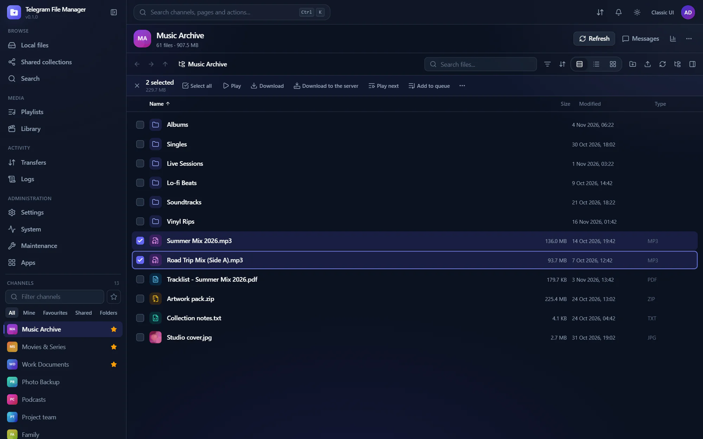
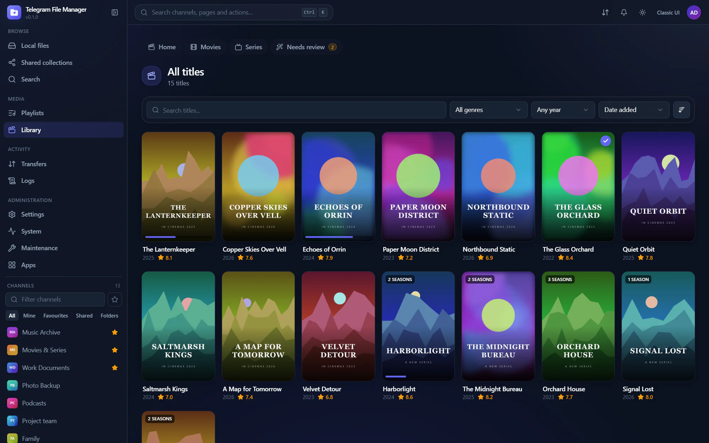
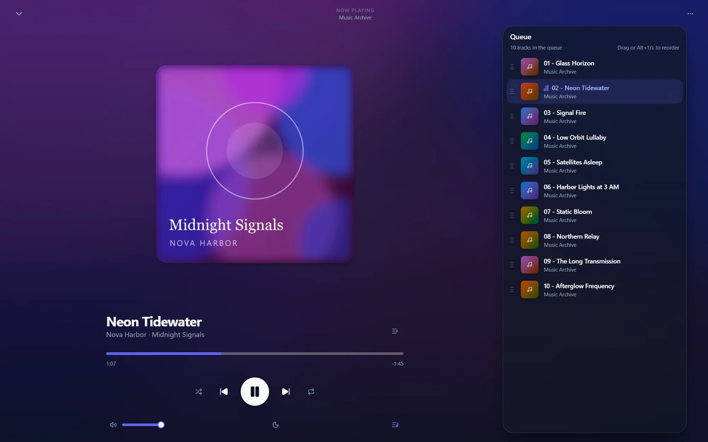
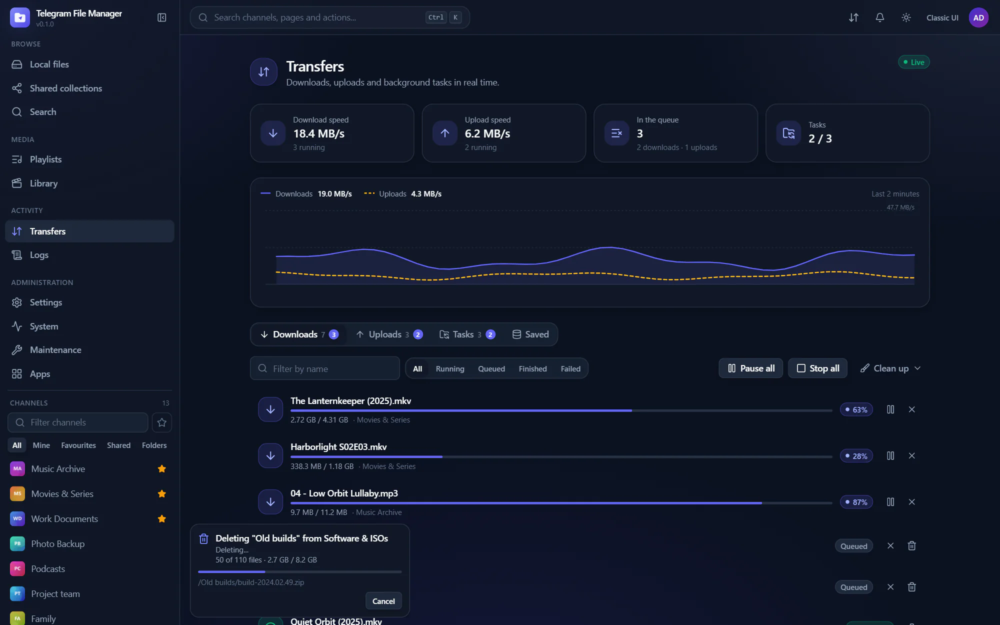

# TelegramFileManager

<p align="center">
  <a href="https://github.com/mateof/TelegramFileManager/actions/workflows/docker-image.yml"></a>
  <a href="https://github.com/mateof/TelegramFileManager/releases/latest"></a>
  <a href="https://github.com/mateof/TelegramFileManager/pkgs/container/telegramfilemanager"></a>
  <a href="https://dotnet.microsoft.com/"></a>
  <a href="https://github.com/mateof/TelegramFileManager/releases"></a>
  <a href="https://github.com/mateof/TelegramFileManager/stargazers"></a>
  <a href="LICENSE"></a>
  <a href="https://github.com/mateof/TelegramFileManager/commits/main"></a>
</p>

With telegramFileManager you can have your own unlimited cloud and manage it through a file system in a simple way.
You will be able to store files of unlimited size.

## New web app

The server also ships a new web interface at **`/app`**: a file manager for your channels, a
media library with posters, a music player with a queue, live transfers, global search and
themes, made for desktop and mobile and installable as an app (PWA). It works side by side with
the classic interface ([details](#web-interface-app)).

<table>
  <tr>
    <td></td>
    <td></td>
  </tr>
  <tr>
    <td></td>
    <td></td>
  </tr>
</table>

More screenshots (viewers, search, settings, light theme, mobile): **[docs/web-app.md](docs/web-app.md)**.

### Classic interface


## Getting started
[Wiki](https://github.com/mateof/TelegramFileManager/wiki)


## Installation
### Previous steps
1. Obtain App_Hash and App_Id in [API development tools](https://my.telegram.org/apps). [How to](https://core.telegram.org/api/obtaining_api_id)
2. Rename file `Configuration/config.example.json` as `Configuration/config.json` and modify it:
  - "mongo_connection_string": "mongodb://\<username>:\<password>@\<server>:\<port>".
  - Complete Api_hash and Api_id.

### PC
- Install [MongoDB](https://www.mongodb.com/try/download/community)
- Install [.Net SDK](https://dotnet.microsoft.com/en-us/download)
- Install [.Net Runtime Run server apps](https://dotnet.microsoft.com/en-us/download/dotnet/10.0) (.NET 10, ASP.NET Core Runtime)

### Docker
Docker Compose.

```
version: "3"
services:
  telegramdownloader:
    image: ghcr.io/mateof/telegramfilemanager:latest
    deploy:
      resources:
        limits:
          memory: 6G
    container_name: telegramfilemanager
    environment:
      connectionString: "mongodb://<username/>:<password/>@mongodb_container:27017"
      api_id: ""
      hash_id: ""
      DOTNET_HOSTBUILDER__RELOADCONFIGONCHANGE: false
      DOTNET_CLI_TELEMETRY_OPTOUT: true
    restart: unless-stopped
    depends_on:
      - mongodb_container
    ports:
      - "8015:8080"
    volumes:
      - <local folder/>:/app/local
      - <folder logs/>:/app/logs
      - <user data/>:/app/datauser
  mongodb_container:
    image: mongo:latest
    container_name: mongodb
    restart: unless-stopped
    environment:
      MONGO_INITDB_ROOT_USERNAME: 
      MONGO_INITDB_ROOT_PASSWORD: 
    ports:
      - 27017:27017
    volumes:
      - <path for mongo data/>:/data/db
  # For debug    
  mongo-express:
    image: mongo-express
    restart: unless-stopped
    environment:
        - ME_CONFIG_MONGODB_SERVER=mongodb
        - ME_CONFIG_MONGODB_PORT=27017
        - ME_CONFIG_MONGODB_ENABLE_ADMIN=true
        - ME_CONFIG_MONGODB_AUTH_DATABASE=admin
        - ME_CONFIG_MONGODB_AUTH_USERNAME=
        - ME_CONFIG_MONGODB_AUTH_PASSWORD=
        - ME_CONFIG_BASICAUTH_USERNAME=
        - ME_CONFIG_BASICAUTH_PASSWORD=
    depends_on:
      - mongodb_container
    ports:
      - "27000:8081"
```

### Security

- **Web password** (Config → Web Security): off by default, which keeps the web UI open as in
  previous versions. Set one before exposing the server outside your network; the web UI, the
  API, the SignalR hubs, the media/file URLs, `/local` and Swagger then need the password
  (cookie session) or the API key. Optional "no password on the local network" for devices that
  connect directly from the LAN; requests through a reverse proxy always need the password.
  Forgot it? Start once with `TFM_RESET_WEB_PASSWORD=true`.
- **Passkeys** (`/app` → Settings → Web security, while a password is set): sign in with
  Bitwarden, 1Password, Windows Hello, Touch ID, a phone or a security key, also from the
  browser's autofill. The password stays as the fallback. Needs HTTPS (or `localhost`) and a host
  name (not an IP address); a passkey only works on the domain it was created on.
- **API key** (Config → API & WebDAV Access): what the Android, TV and TFM Player apps use. While
  a web password is set it is the only way in for the apps.
- **Reverse proxy**: only proxies in `TrustedProxies` (default: loopback and private ranges) may
  set `X-Forwarded-*`. Set e.g. `TrustedProxies=172.18.0.0/16` to restrict it.

Details: [docs/api/authentication.md](docs/api/authentication.md#web-session).

## Web interface (`/app`)

Besides the classic interface at `/`, the server ships a new web interface at
**`http://<server>:<port>/app/`**: a React app built on the REST API v1, made for desktop
and mobile (themes, command palette with `Ctrl/Cmd+K`, touch layout with a bottom
navigation bar). Both interfaces work over the same Telegram session and settings, and you
can switch between them at any time (a tour with screenshots: [docs/web-app.md](docs/web-app.md)):

- From the classic interface: the **New interface** button in the side menu (also in the
  mobile menu), or the banner shown until you choose "Don't show again".
- From the new one: **Classic UI** in the top bar or the user menu.
- **Default interface** (Config → Web Interface → *Open the new interface by default*, or
  `defaultWebUi` in `PATCH /api/v1/config`): when enabled, a browser opening `/` is sent to
  `/app/`. Only the root is redirected (links to classic pages keep working).
  `/?ui=classic` opens the classic interface and keeps it at `/` for that browser (cookie
  `tfm_ui`); `/?ui=app` undoes that.

Access works the same way for both interfaces (see [Security](#security)):

- **No password** (default): open to anyone who can reach the server, as before.
- **Web password** (Config → Web Security, or the first screen of `/app` while none is set):
  browsers sign in at `/app/login` and get a session cookie (`HttpOnly`, `SameSite=Strict`;
  "remember me" keeps it for 30 days, otherwise it expires after 12 h idle). The classic
  interface sends you there too. Passkeys can be added as an extra way to sign in.
- **No password on the local network** (optional, only while a password is set): devices that
  connect *directly* from a private/loopback address to a local host name (IP, `localhost`,
  `nas`, `*.local`…) get in without it. Anything that arrives through a reverse proxy always
  needs the password.
- The apps (Android, Android TV, TFM Player) keep using the **API key**.

The Docker images and the release ZIPs include the built web app. Running from source
without building it shows a short "web app not built" page at `/app`.

## Compile

> dotnet publish -c Release --output ./MyTargetFolder .\TelegramDownloader.csproj

That builds the server only (no Node needed). To include the web app (`/app`) you need
**Node.js 22+**; either let the publish build it:

> dotnet publish -c Release -p:BuildWebApp=true --output ./MyTargetFolder .\TelegramDownloader.csproj

or build it yourself first (the next `dotnet publish` copies it into the output):

```bash
cd TelegramDownloader/ClientApp
npm ci
npm run build        # typecheck + build into TelegramDownloader/wwwroot/app
```

`dotnet build` / `dotnet run` never run npm, so they stay fast; `dotnet run` serves whatever
is in `wwwroot/app`. For front-end work use `npm run dev` (Vite at
`http://localhost:5173/app/`, proxying the API to the running server); see
[`TelegramDownloader/ClientApp/README.md`](TelegramDownloader/ClientApp/README.md).
Docker builds the web app in its own stage (`docker build ./TelegramDownloader`).

## Usage

- Create a private or public channel on Telegram.
- The new channel will appear on the left side panel.
- Click on the folder icon and you will access the file manager.
- Go to the tab called `local`.
- Select the files or folders you want to upload to Telegram.
- Click on the `Upload Telegram` option in the menu.
- You can see the upload progress by clicking on the three dots located in the upper right position, which will display the right side panel. Then click on the `Tasks` option.
- When the upload tasks are finished, you will be able to see the uploaded files in the file manager, in the `Remote` tab.
- When you want, you can download the files again to a location on your local computer, selecting the files or folders and clicking the `Download to Local` button.


## Android apps

Both apps are native Kotlin + Jetpack Compose clients built on the server's REST API v1
(`/api/v1`), documented in [`docs/api`](docs/api). Point them at your server address and
API key and they work over the same Telegram session as the web.

### Phone and tablet — [tfm-android-app](https://github.com/mateof/tfm-android-app)

Full file manager on the go:

- Telegram login from the app, by **QR** or phone number (with 2FA).
- **Channels**: saved / all / favourites, search, statistics, create a channel, join by
  invitation, leave, and build or refresh a channel index choosing which media types to
  scan.
- **File browser** with breadcrumbs, filters, recursive search, multi-select, folder
  creation, rename, copy/move, delete, **upload from the device** and download to the
  server or to the device.
- **Server local storage**: browse, upload, send to a Telegram channel without
  re-uploading the bytes, and clear the streaming cache.
- **Live transfers** over the `/hubs/transfers` SignalR hub: speed, progress and queues,
  with global and per-item pause, resume, cancel and retry.
- **Background audio player** (Media3 + MediaSession) with a mini player and server-side
  playlists, plus **video streaming** for channel and local files.
- Server settings: simultaneous downloads, parallel chunks, connections per download.

### Android TV and Fire TV — [tfm-android-tv-app](https://github.com/mateof/tfm-android-tv-app)

A D-pad first client focused on watching the videos you keep in your channels:

- Channels split into mine, shared, favourites, Telegram chat folders and all, with a
  name search.
- Folder navigation inside a channel, an **all videos** view and a **messages** view,
  each sortable by name, date or size.
- Playback with the built-in player (ExoPlayer plus FFmpeg software decoders, so MKV or
  AVI with AC3/DTS play fine), VLC, any other installed player or the system default.
- Updates itself from GitHub Releases, and runs on Android 6.0, which covers Fire TV
  sticks from 2015 onwards.
- **Library** (Plex/Emby style): the server identifies the movies and series in your
  channels through TMDB and/or OMDb, caches posters and keeps playback progress, so the TV
  shows a catalogue with "continue watching", next episodes, watched marks and a way to
  fix a wrong identification. Enable it and add the provider keys in the Config page.

## Music player


You can use this PWA to connect it to your TelegramFileManager server

[Repository](https://github.com/mateof/TFMPlayer)

[Music player PWA for TelegramFileManager](https://mateof.github.io/TFMPlayer/)

## Mentions

- [Syncfusion](https://www.syncfusion.com/blazor-components)
- [Blazor Bootstrap](https://demos.blazorbootstrap.com/)
- [WTelegramClient](https://github.com/wiz0u/WTelegramClient)

<!---

## Name

## Description

## Badges

## Visuals


## Support


## Roadmap


## Contributing


## Authors and acknowledgment

-->

## License
- GPLv3

<!--

## Project status

-->
