# The web app (`/app`)

Besides the classic interface at `/`, TelegramFileManager serves a new web interface at
**`http://<server>:<port>/app/`**. It is a React app built on the [REST API v1](api/README.md),
made for desktop and mobile, and it works over the same Telegram session and settings as the
classic interface: switch between them with **Classic UI** in the top bar or the **New interface**
button of the classic side menu. Setup, access and the default-interface option are described in
the [README](../README.md#web-interface-app).

What it includes:

- **File manager** for every channel: folders, details / list / grid views with thumbnails,
  multiple selection, folder tree, details panel, new folders, uploads, downloads to your device
  or to the server, rename / copy / move / delete (deletes show their progress and can be
  cancelled).
- **Local files**: the server's storage, with upload to a Telegram channel.
- **Media library**: movies and series identified from the channel indexes (TMDB / OMDb), with
  posters, "continue watching", seasons and episodes, and a review queue for files that could
  not be matched.
- **Music player** with a queue, cover art and tags read from the files, shuffle / repeat, sleep
  timer and **playlists**; it keeps playing while you browse.
- **Viewers** for video (with watch progress for the library), images (gallery of the folder),
  PDF and text.
- **Transfers** in real time over SignalR: downloads, uploads and batch tasks with speed chart,
  pause / stop, the queue and the saved tasks.
- **Global search** across every channel and the local storage.
- Channel **messages**, channel refresh with live progress, **shared collections**, logs, system
  metrics and maintenance.
- **Settings** for the server, plus appearance (themes, accent colour, effects, density) and the
  language: **Español, Galego and English**.
- Command palette (`Ctrl/Cmd+K`), mobile layout with a bottom navigation bar and a drawer, and the
  player always visible.
- **Installable app (PWA)** with an offline shell and an update prompt (needs HTTPS or
  `localhost`), sign-in with the web password or **passkeys**.

> The screenshots below use demo data: the channels, files, titles and artwork are invented and
> were generated for this page.

## Channels

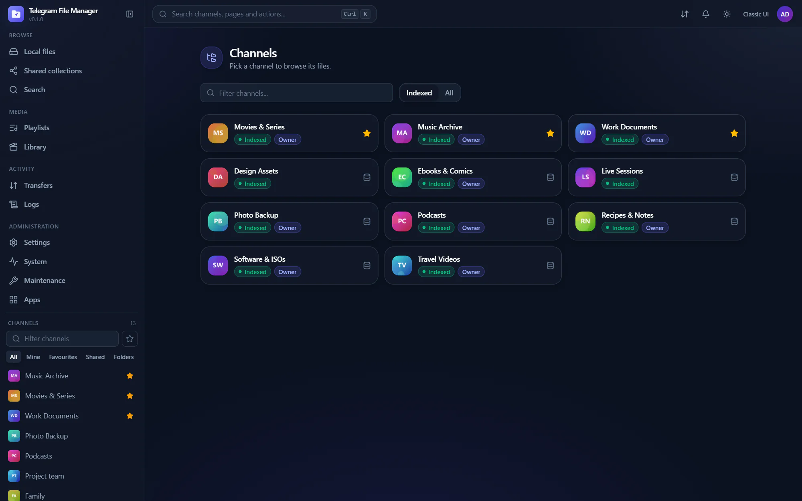

The channels of the account, with favourites, ownership and whether they are indexed; the
sidebar lists them too (all, mine, favourites, shared, Telegram folders).

## File manager

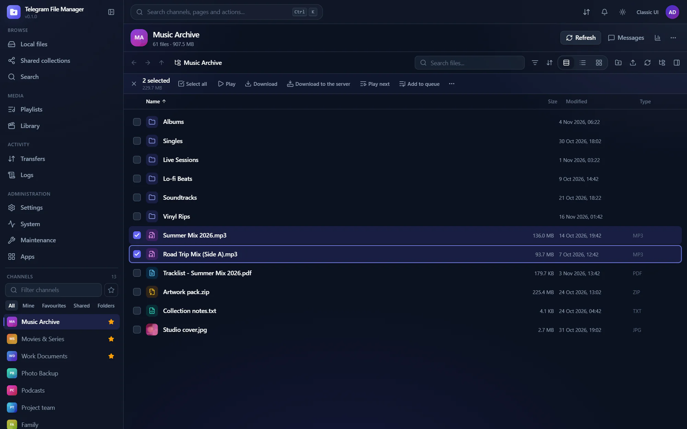

Details view with a selection: the bar shows the actions that apply to it (play, download, download
to the server, queue…).

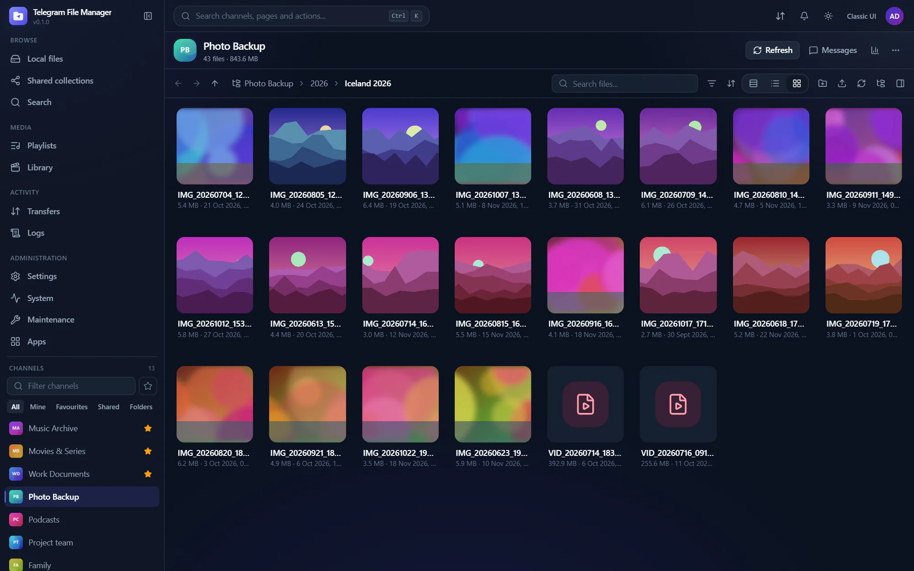

Grid view with thumbnails of a photo folder.

## Media library

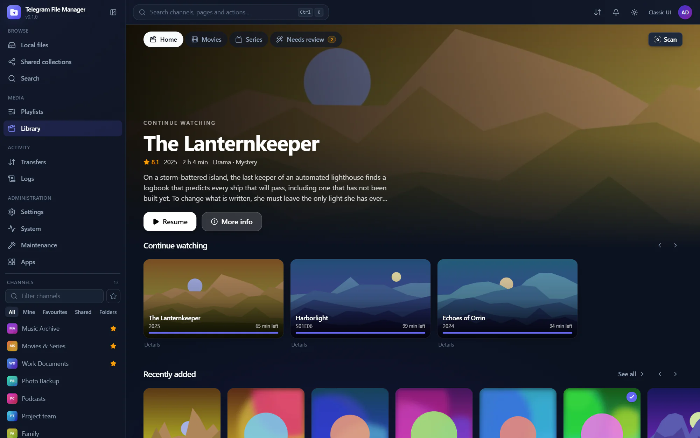

The library home: the title to resume, "continue watching" and the latest additions.

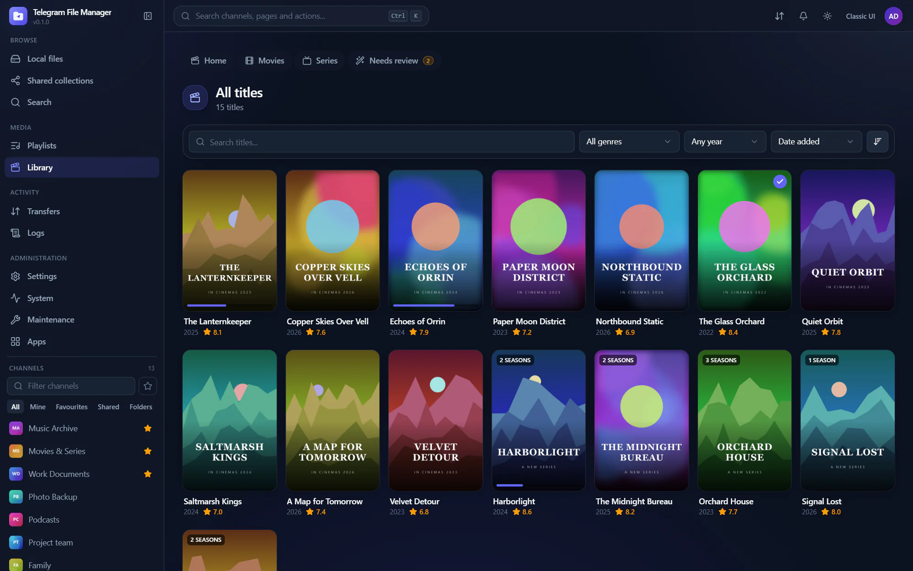

All the titles, with filters by genre and year and the watch progress of each one.

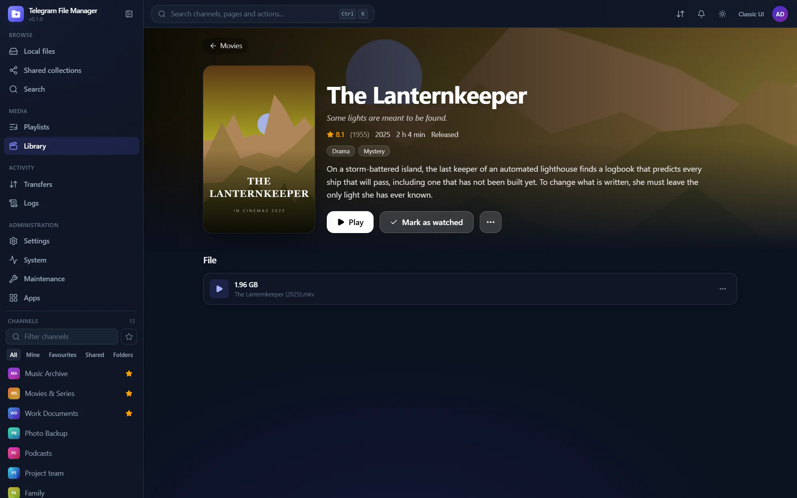

A movie: resume, play from the start or mark it as watched.

## Music player

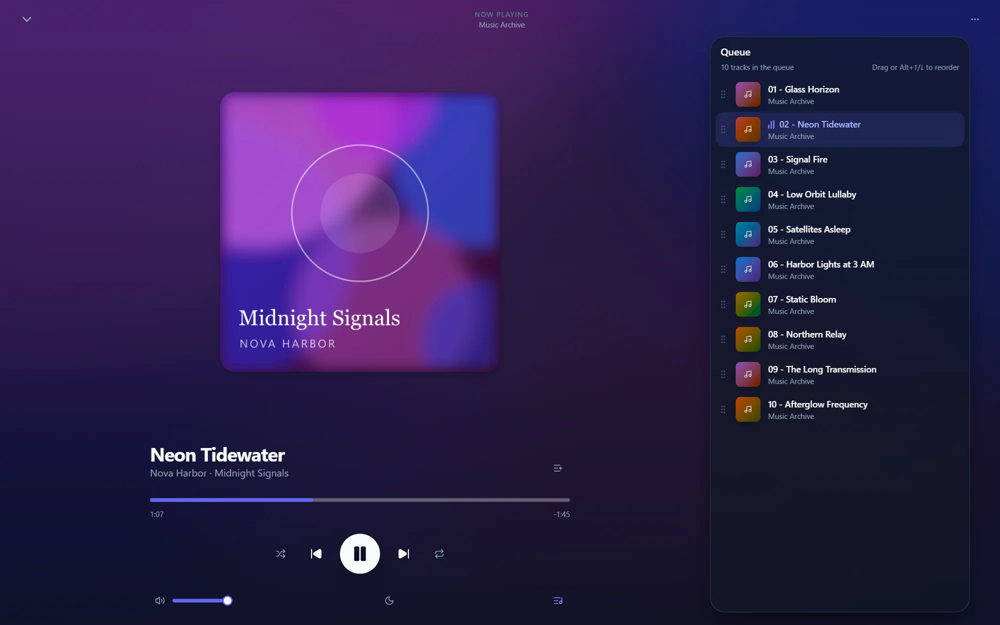

The expanded player with the queue; collapsed, it stays as a bar at the bottom of every page.

## Viewers

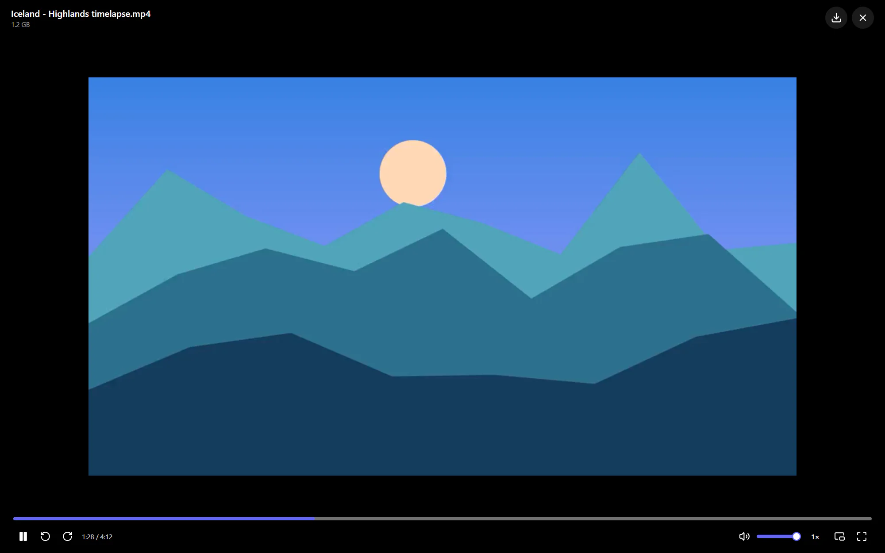

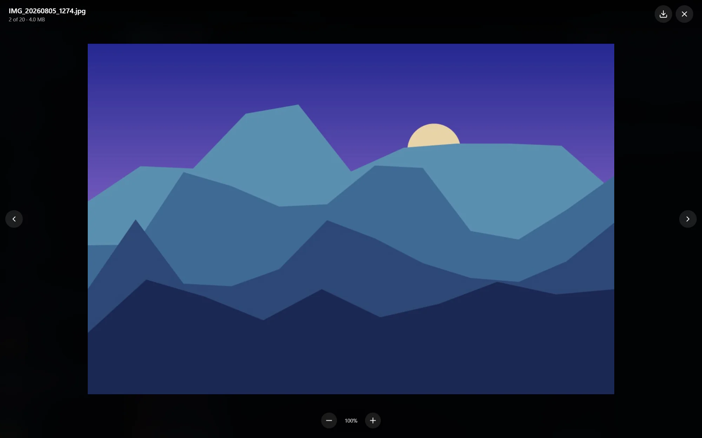

## Transfers

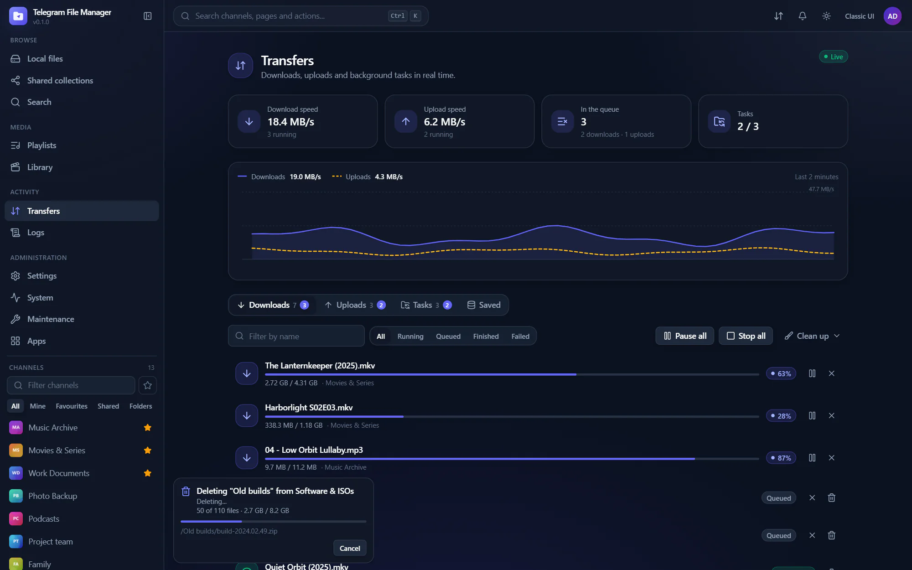

Live downloads, uploads and tasks with the speed chart; bottom left, the progress card of a folder
being deleted.

## Search

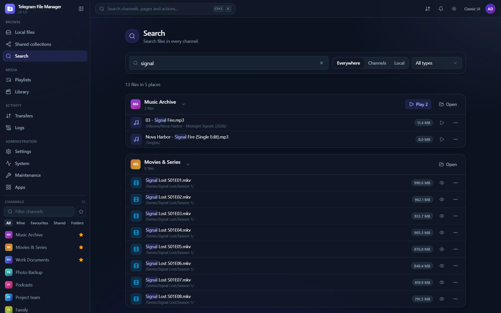

## Settings and themes

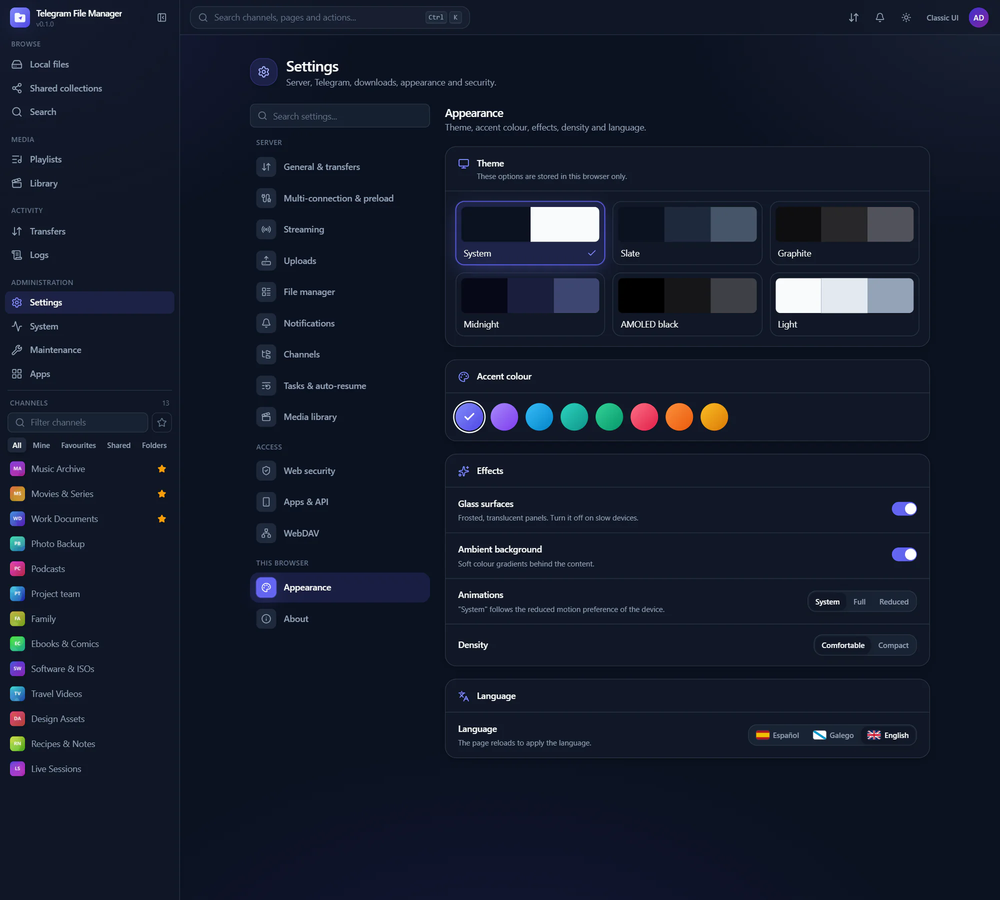

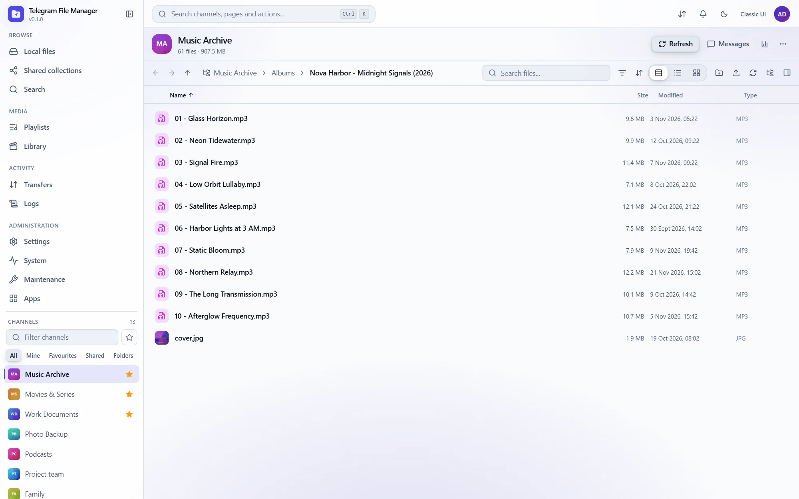

## Mobile

  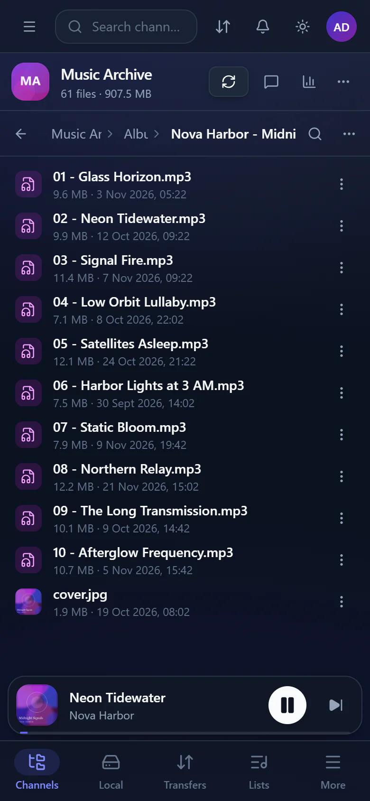
  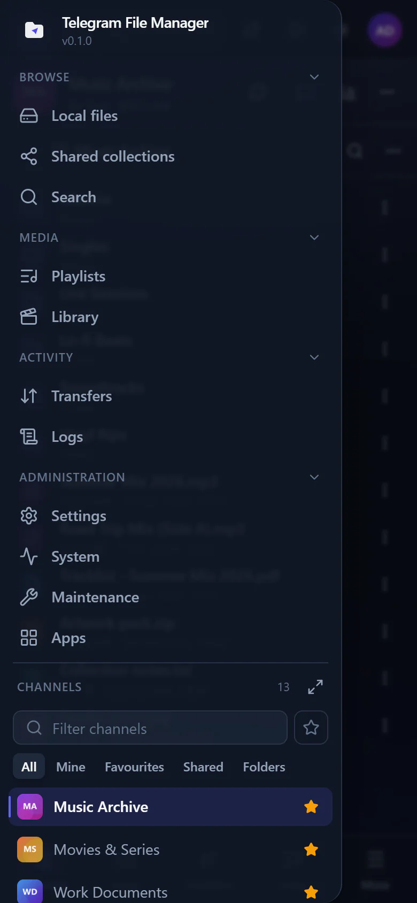
  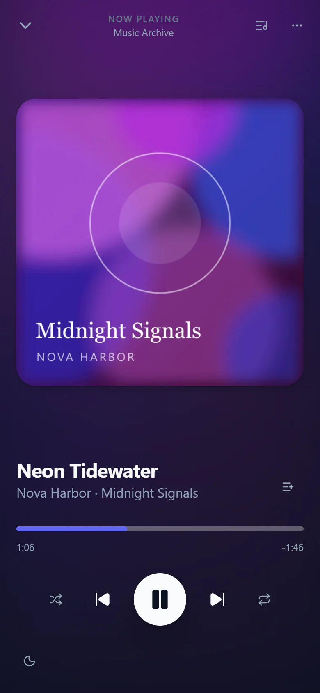

